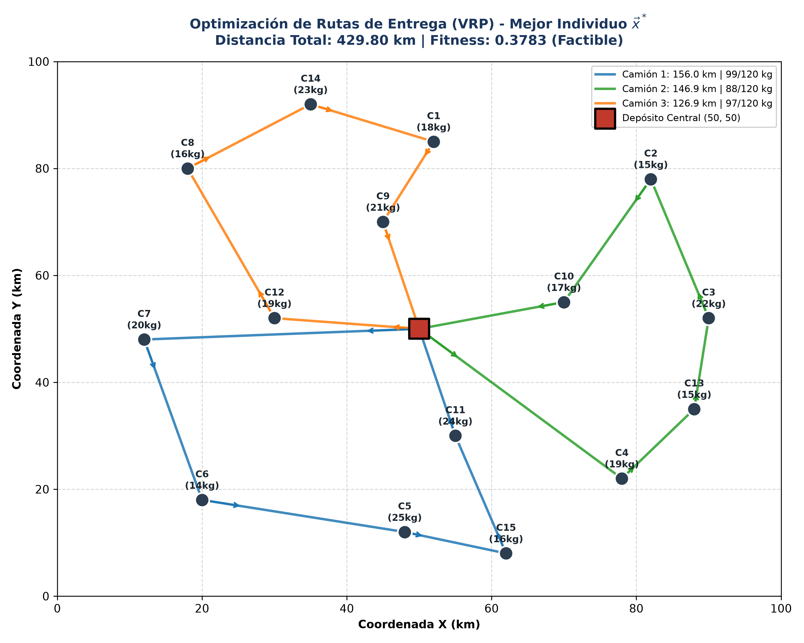
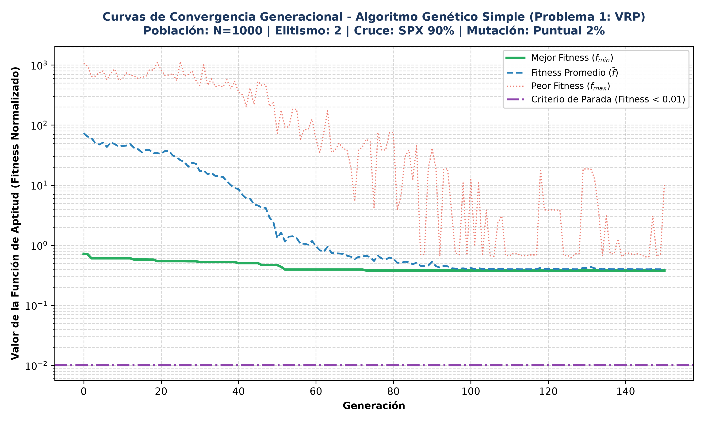

# Cuarto Taller — Trabajo Final de Algoritmos Genéticos (AG)

[](https://www.python.org/)
[](src/web/index.html)
[](https://www.chartjs.org/)
[](LICENSE)
[](https://www.unicartagena.edu.co/)


> **Institución:** Universidad de Cartagena — Facultad de Ingeniería  
> **Programa:** Ingeniería de Sistemas — Semestre VII  
> **Asignatura:** Inteligencia Artificial (Corte 3)  
> **Docente:** Ing. Manuel Alejandro Ospina Alarcón  
> **Autor Exclusivo:** Dago David Palmera Navarro (Cód. 0222321003)  
> **Fecha de Publicación:** 27 de octubre de 2026  
> **Fecha de Entrega:** Jueves 05 de noviembre de 2026  
> **Ponderación:** 10 puntos de la calificación definitiva del Tercer Corte  

---

## Tabla de Contenidos

- [1. Descripción General del Proyecto](#1-descripción-general-del-proyecto)
- [2. Estructura del Repositorio](#2-estructura-del-repositorio)
- [3. Parámetros Canónicos de Configuración](#3-parámetros-canónicos-de-configuración)
- [4. Problema 1: Optimización de Rutas de Entrega (VRP)](#4-problema-1-optimización-de-rutas-de-entrega-vrp)
  - [4.1 Contexto y Definición del Problema](#41-contexto-y-definición-del-problema)
  - [4.2 Codificación Cromosómica (RKGA)](#42-codificación-cromosómica-rkga)
  - [4.3 Función Objetivo, Normalización y Penalizaciones](#43-función-objetivo-normalización-y-penalizaciones)
  - [4.4 Resultados Empíricos Certificados](#44-resultados-empíricos-certificados)
  - [4.5 Evidencia Científica y Gráficas de Simulación](#45-evidencia-científica-y-gráficas-de-simulación)
- [5. Problema 2: Diseño de Circuitos Electrónicos (PCB Layout)](#5-problema-2-diseño-de-circuitos-electrónicos-pcb-layout)
- [6. Problema 3: Optimización de Cartera de Inversiones (Markowitz)](#6-problema-3-optimización-de-cartera-de-inversiones-markowitz)
- [7. Arquitectura de Software y Módulos de Código](#7-arquitectura-de-software-y-módulos-de-código)
  - [7.1 Orquestador CLI (`src/main.py`)](#71-orquestador-cli-srcmainpy)
  - [7.2 Motor Genético Universal (`src/core/ga_engine.py`)](#72-motor-genético-universal-srccorega_enginepy)
  - [7.3 Modelado del Problema VRP (`src/problems/vrp.py`)](#73-modelado-del-problema-vrp-srcproblemsvrppy)
  - [7.4 Capa Web Interactiva (`src/web/`)](#74-capa-web-interactiva-srcweb)
- [8. Guía de Instalación y Ejecución](#8-guía-de-instalación-y-ejecución)
  - [8.1 Requisitos Previos](#81-requisitos-previos)
  - [8.2 Configuración del Entorno Virtual](#82-configuración-del-entorno-virtual)
  - [8.3 Ejecución de la Simulación en Python (CLI)](#83-ejecución-de-la-simulación-en-python-cli)
  - [8.4 Despliegue y Uso del Dashboard Web](#84-despliegue-y-uso-del-dashboard-web)
- [9. Licencia y Declaración de Autoría](#9-licencia-y-declaración-de-autoría)

---

## 1. Descripción General del Proyecto

Este proyecto constituye la entrega formal del **Trabajo Final del Tercer Corte de Inteligencia Artificial**, enfocado en el diseño, implementación, calibración y evaluación de **Algoritmos Genéticos Canónicos (SGA - Simple Genetic Algorithm)** para resolver tres problemas de optimización combinatoria y continua de alta complejidad computacional ($NP\text{-hard}$):

1. **Problema 1:** Optimización de Rutas de Entrega de Vehículos (*Capacitated Vehicle Routing Problem* - CVRP con jornada límite).
2. **Problema 2:** Optimización del Posicionamiento de Componentes en Placas de Circuitos Impresos (*Printed Circuit Board* - PCB Layout).
3. **Problema 3:** Selección y Optimización de Cartera de Inversiones Financieras (*Markowitz Mean-Variance Portfolio*).

El sistema fue concebido bajo un paradigma de **arquitectura modular desacoplada**, separando estrictamente:

- **Motor Evolutivo en Python:** Encargado del cómputo intensivo, operaciones matriciales con NumPy, operadores canónicos idénticos a las rutinas de cátedra en MATLAB, manejo de restricciones por penalización exterior y exportación determinística de datasets estructurados.
- **Suite Web de Auditoría e Interfaz Visual (Dashboard SPA):** Construido exclusivamente con tecnologías web nativas (**HTML5**, **CSS3** con tokens semánticos Glassmorphism Dark-Tech y **JavaScript ES6+**), permitiendo una auditoría interactiva sin depender de un servidor de aplicaciones o frameworks externos.

---

## 2. Estructura del Repositorio

El diseño del directorio mantiene la rigurosidad y estándares de presentación de los proyectos previos del semestre, centralizando la lógica ejecutable dentro del directorio `src/`:

```text
cuarto-taller-algoritmos-geneticos-ia/
├── data/                                 # Datasets exportados en formato JSON estructurado
│   └── vrp_results.json                  # Métricas de mejor individuo, rutas e historial generacional
├── docs/                                 # Documentación técnica, capítulos e imágenes 300 DPI
│   ├── img/                              # Figuras científicas exportadas en alta resolución
│   │   ├── figura1_vrp_rutas_optimas.png # Mapeo cartesiano y rutas de la flota de reparto
│   │   └── figura2_vrp_convergencia.png  # Gráfico de evolución generacional (Mejor, Promedio, Peor)
│   └── secciones/                        # Capítulos modulares del informe académico en Markdown
│       ├── 01_Introduccion_y_Objetivos.md
│       ├── 02_Fundamentacion_Teorica.md
│       └── 03_Problema_1_VRP.md
├── algoritmos_referencia/                # Implementaciones base de cátedra en MATLAB (.txt)
│   ├── Algoritmo_Genetico_Clasico.txt
│   └── Algoritmo_Genetico_Real.txt
├── src/                                  # CÓDIGO FUENTE GLOBAL DEL PROYECTO
│   ├── main.py                           # CLI unificado, orquestador de modelos y pipeline de exportación
│   ├── core/                             # Motor SGA universal desacoplado
│   │   ├── __init__.py
│   │   └── ga_engine.py                  # Algoritmo genético canónico parametrizable (estándar MATLAB)
│   ├── problems/                         # Formulaciones matemáticas y decodificadores de problemas
│   │   ├── __init__.py
│   │   └── vrp.py                        # Problema 1: Modelo VRP, decodificador RKGA y visualizador
│   └── web/                              # Capa de presentación visual (Dashboard SPA autónomo)
│       ├── index.html                    # Dashboard interactivo con Canvas 2D y auditoría Chart.js
│       ├── styles.css                    # Design System Glassmorphism Dark-Tech con tokens CSS
│       ├── app.js                        # Controlador visual, animación de flota e inspectores de rutas
│       └── data/                         # Datasets sincronizados para consumo web directo
│           ├── vrp_results.json          # Formato JSON estándar
│           └── vrp_results.js            # Objeto window.VRP_SIMULATION_DATA (soporte file://)
├── Entrega/                              # Documento final editable en formato Word (.docx)
├── .gitignore                            # Filtros de exclusión para control de versiones
├── .markdownlint.json                    # Reglas de estandarización para Markdownlint
├── LICENSE                               # Licencia de código abierto MIT
└── README.md                             # Documentación global del entorno de trabajo
```

---

## 3. Parámetros Canónicos de Configuración

Para garantizar estricta reproducibilidad y alineación con las pautas teóricas y prácticas impartidas por el docente, el motor genético se calibra con la siguiente configuración canónica:

| Parámetro | Valor Canónico | Justificación y Comportamiento Algorítmico |
| :--- | :--- | :--- |
| **Tamaño de Población ($N$)** | $1000$ individuos | Garantiza adecuada diversidad genética y cobertura del espacio de búsqueda hiperdimensional. |
| **Generaciones Máximas ($G_{\max}$)** | $150$ épocas | Horizonte suficiente para observar estabilidad asintótica y convergencia del fitness. |
| **Elitismo ($k$)** | $2$ individuos | Preservación obligatoria de los dos especímenes con mejor fitness directamente a la siguiente generación. |
| **Operador de Selección** | Torneo Determinístico ($p = 2$) | Se eligen 2 individuos aleatoriamente y el de menor fitness gana la reproducción, equilibrando presión selectiva. |
| **Operador de Cruce** | Cruce en un Punto (SPX) | Punto de corte aleatorio; herencia segmentada de bloques cromosómicos (información post-corte). |
| **Tasa de Cruce ($P_c$)** | $90\%$ ($0.90$) | Alta recombinación para explotar combinaciones promisorias de bloques génicos constructivos. |
| **Operador de Mutación** | Mutación Puntual Aleatoria | Sustitución de un gen seleccionado al azar por un alelo aleatorio continuo uniforme $\mathcal{U}(0, 1)$. |
| **Tasa de Mutación ($P_m$)** | $2\%$ ($0.02$) | Tasa conservadora para inyectar diversidad y mitigar la convergencia prematura a óptimos locales. |
| **Criterio de Parada** | Fitness $\le 10^{-2}$ ($0.01$) | Criterio de tolerancia mínima o agotamiento del límite de generaciones programadas. |

---

## 4. Problema 1: Optimización de Rutas de Entrega (VRP)

### 4.1 Contexto y Definición del Problema

El **Problema de Enrutamiento de Vehículos Capacitado (CVRP)** modela las operaciones de distribución física de una empresa de paquetería metropolitana. La infraestructura logística consta de:

- **Depósito Central ($D$):** Ubicado en las coordenadas cartesianas $(50.0, 50.0)\,\text{km}$.
- **Flota Homogénea:** $K = 3$ camiones de reparto.
- **Capacidad de Carga Máxima:** $Q_k = 120.0\,\text{kg}$ por vehículo.
- **Jornada Laboral Máxima:** $T_k = 480.0\,\text{min}$ ($8.0\,\text{horas}$) por camión.
- **Velocidad Promedio de Tránsito:** $V = 45.0\,\text{km/h}$ ($0.75\,\text{km/min}$).
- **Clientes Demandantes:** $M = 15$ puntos georreferenciados $(x_i, y_i)$, cada uno con demanda $q_i \in [12, 28]\,\text{kg}$ y tiempo de atención $s_i \in [15, 30]\,\text{min}$. La carga total del sistema asciende a $\sum_{i=1}^{15} q_i = 284.0\,\text{kg}$.

### 4.2 Codificación Cromosómica (RKGA)

Se utiliza una representación por **Claves Aleatorias (RKGA - *Random Keys Genetic Algorithm*)**, donde cada individuo se modela como un vector continuo de dimensión $15$:

$$\vec{c} = [g_1, g_2, \dots, g_{15}], \quad g_i \in [0, 1]$$

La decodificación a una secuencia de atención se realiza aplicando la operación de ordenamiento de índices (`argsort`):

$$\pi = \text{argsort}(\vec{c})$$

Posteriormente, un decodificador voraz particiona la permutación $\pi$ en $K=3$ rutas disjuntas, asignando clientes secuencialmente al camión actual hasta saturar su capacidad o agotar los vehículos disponibles.

### 4.3 Función Objetivo, Normalización y Penalizaciones

El costo total no restringido de una solución corresponde a la sumatoria de distancias euclidianas recorridas por toda la flota, saliendo del depósito y retornando a él:

$$F_{\text{dist}}(\vec{c}) = \sum_{k=1}^{K} d_k(\pi_k)$$

Las violaciones a la capacidad de carga ($C_{\text{viol}}$) y a la duración de la jornada ($T_{\text{viol}}$) se castigan mediante una función de penalización exterior cuadrática estricta:

$$F_{\text{penalizado}} = F_{\text{dist}} + 50.0 \times C_{\text{viol}} + 2.0 \times T_{\text{viol}} + 5.0 \times (C_{\text{viol}})^2 + 0.1 \times (T_{\text{viol}})^2$$

Para acotar el fitness en el intervalo $[0, 1]$ conforme al estándar de cátedra, se aplica una normalización lineal contra una distancia máxima de referencia $F_{\max} = 1500.0\,\text{km}$:

$$f_{\text{norm}}(\vec{c}) = \min\left(1.0, \; \frac{F_{\text{penalizado}}(\vec{c})}{F_{\max}}\right)$$

$$\text{Aptitud}(\vec{c}) = 1.0 - f_{\text{norm}}(\vec{c})$$

### 4.4 Resultados Empíricos Certificados

La ejecución del algoritmo genético con semilla aleatoria controlada (`seed=42`) sobre una población de $1000$ individuos durante $150$ generaciones arrojó los siguientes resultados certificados:

| Métrica Global | Valor Obtenido | Estado / Validación |
| :--- | :--- | :--- |
| **Distancia Total Recorrida** | **$429.80\,\text{km}$** | Minimización efectiva global |
| **Tiempo de Cómputo (CPU)** | **$3.72\,\text{segundos}$** | Alto rendimiento con NumPy vectorizado |
| **Sobrecarga de Capacidad** | **$0.00\,\text{kg}$** | **$100\%$ Factible** (Sin violaciones) |
| **Exceso de Jornada Laboral** | **$0.00\,\text{minutos}$** | **$100\%$ Factible** (Sin violaciones) |
| **Fitness Normalizado Mínimo** | **$0.378254$** | Fitness óptimo alcanzado |
| **Aptitud Máxima** | **$0.621746$** | Aptitud biológica del mejor espécimen |

#### Desglose Operativo por Vehículo

| Vehículo | Secuencia de Clientes Atendidos | Distancia ($km$) | Carga Transportada | Tiempo Total ($min$) | Holgura Carga | Holgura Jornada |
| :---: | :--- | :---: | :---: | :---: | :---: | :---: |
| **Camión 1** | $D \to \text{C7} \to \text{C6} \to \text{C5} \to \text{C15} \to \text{C11} \to D$ | $156.00$ | $99.0\,\text{kg}$ ($82.5\%$) | $305.00$ ($5.08\,\text{h}$) | $+21.0\,\text{kg}$ | $+175.0\,\text{min}$ |
| **Camión 2** | $D \to \text{C4} \to \text{C13} \to \text{C3} \to \text{C2} \to \text{C10} \to D$ | $146.88$ | $88.0\,\text{kg}$ ($73.3\%$) | $292.84$ ($4.88\,\text{h}$) | $+32.0\,\text{kg}$ | $+187.2\,\text{min}$ |
| **Camión 3** | $D \to \text{C12} \to \text{C8} \to \text{C14} \to \text{C1} \to \text{C9} \to D$ | $126.92$ | $97.0\,\text{kg}$ ($80.8\%$) | $276.23$ ($4.60\,\text{h}$) | $+23.0\,\text{kg}$ | $+203.8\,\text{min}$ |
| **Totales** | **15 clientes cubiertos** | **429.80** | **284.0 kg (100%)** | **874.07 min** | **Óptimo** | **Factible** |

### 4.5 Evidencia Científica y Gráficas de Simulación

El pipeline exporta automáticamente visualizaciones vectoriales a $300\,\text{DPI}$ dentro de `docs/img/`:

- **Mapa Cartesiano de Rutas Óptimas:**  
  Ilustra la partición territorial de los 15 clientes respecto al depósito central $(50, 50)$, evidenciando rutas convexas que evitan auto-intersecciones:

  

- **Curvas de Convergencia Evolutiva (150 Generaciones):**  
  Demuestra la evolución paralela del mejor individuo, el promedio de la población y el peor individuo a lo largo de las generaciones, exhibiendo un descenso asintótico estable:

  

---

## 5. Problema 2: Diseño de Circuitos Electrónicos (PCB Layout)

> **Estado del Módulo:** `[EN DESARROLLO / STAND-BY]`  
> *Este módulo se encuentra formalmente planteado y estructurado, listo para su integración en la siguiente iteración.*

### Planteamiento y Objetivos Técnicos

El problema aborda la ubicación espacial óptima de $N$ componentes microelectrónicos (circuitos integrados, microcontroladores, capacitores, resistencias) sobre un sustrato de placa bidimensional de dimensiones confinadas:

- **Función Objetivo:** Minimizar la longitud total de las pistas de interconexión (*Wirelength Optimization* utilizando distancia Manhattan o Euclidian Splines) y minimizar el área del rectángulo envolvente (*Bounding Box*).
- **Restricciones Físicas:**
  - Garantizar distancias mínimas de aislamiento dieléctrico ($d_{ij} \ge d_{\min}$) para prevenir colisiones físicas y minimizar la interferencia electromagnética (*Electromagnetic Interference* - EMI y diafonía/crosstalk).
  - Confinamiento estricto dentro de las fronteras de la placa ($0 \le x_i \le W$, $0 \le y_i \le H$).
- **Estrategia Genética Prevista:** Codificación continua/entera de coordenadas espaciales $(x_i, y_i)$ y orientaciones angulares $(\theta_i \in \{0^\circ, 90^\circ, 180^\circ, 270^\circ\})$, evaluada mediante detección de colisiones por cajas envolventes (AABB) y penalización por solapamiento geométrico.

---

## 6. Problema 3: Optimización de Cartera de Inversiones (Markowitz)

> **Estado del Módulo:** `[EN DESARROLLO / STAND-BY]`  
> *Este módulo se encuentra formalmente planteado y estructurado, listo para su integración en la siguiente iteración.*

### Planteamiento y Fundamento Teórico

El problema implementa el modelo de selección de portafolio de media-varianza propuesto por **Harry Markowitz** (Premio Nobel de Economía), cuyo propósito es determinar la asignación óptima de capital entre un conjunto de activos financieros:

- **Función Objetivo Multicriterio:** Maximizar el retorno esperado del portafolio $\mathbb{E}[R_p] = \vec{w}^T \vec{\mu}$ mientras se minimiza simultáneamente la volatilidad o varianza de la cartera $\sigma_p^2 = \vec{w}^T \Sigma \vec{w}$ (determinando la **Frontera Eficiente**).
- **Restricciones del Portafolio:**
  - Presupuesto total unitario: $\sum_{i=1}^{M} w_i = 1.0$.
  - No negatividad (posiciones largas exclusivamente, sin ventas en corto): $w_i \ge 0, \; \forall i$.
  - Límite máximo de concentración por activo individual ($w_i \le w_{\max}$) para garantizar diversificación del riesgo sistémico.
- **Estrategia Genética Prevista:** Cromosoma continuo donde los genes representan pesos ponderados que se normalizan mediante la función Softmax o normalización de suma unitaria $\hat{w}_i = \frac{w_i}{\sum w_j}$, maximizando el Ratio de Sharpe.

---

## 7. Arquitectura de Software y Módulos de Código

El código fuente del proyecto se estructura en cuatro módulos principales con responsabilidades de diseño bien delimitadas:

### 7.1 Orquestador CLI (`src/main.py`)

Es el punto de entrada unificado para la consola de comandos. Sus funciones clave comprenden:

- Análisis de argumentos por CLI (`argparse`): `--problem`, `--pop-size`, `--generations`, `--crossover`, `--mutation`, `--benchmark`, `--export`.
- Orquestación del flujo de cómputo genético y recolección de estadísticas de tiempo de ejecución con precisión de microsegundos.
- **Pipeline de Exportación Automática:** Genera sincrónicamente los archivos `data/vrp_results.json`, `src/web/data/vrp_results.json` y `src/web/data/vrp_results.js`, garantizando que la interfaz web consuma datos idénticos y certificados.

### 7.2 Motor Genético Universal (`src/core/ga_engine.py`)

Implementa la clase `GeneticAlgorithm`, un motor evolutivo completamente agnóstico del dominio del problema:

- **Inicialización:** Población de números reales continuos en matriz NumPy de dimensión $(N, D)$.
- **Elitismo Preservativo:** Copia íntegra de los $k$ mejores individuos directamente a la matriz de la siguiente generación antes de iniciar cruces.
- **Torneo Determinístico ($p=2$):** Selección aleatoria por pares donde el individuo con menor fitness accede a la fase de reproducción.
- **Cruce SPX (*Single Point Crossover*):** División de los cromosomas de los dos progenitores en un punto pseudoaleatorio con probabilidad $P_c = 0.90$.
- **Mutación Puntual:** Alteración aleatoria de un locus cromosómico con valor uniforme $\mathcal{U}(0, 1)$ bajo probabilidad $P_m = 0.02$.
- **Auditoría Generacional:** Registra en cada época el mejor fitness, el promedio poblacional, el peor individuo y la desviación estándar para el análisis de convergencia.

### 7.3 Modelado del Problema VRP (`src/problems/vrp.py`)

Contiene las clases `VRPInstance` y `VRProblem`:

- Almacena la matriz de coordenadas cartesianas, demandas de clientes y tiempos de atención.
- Implementa el decodificador RKGA para mapear cromosomas a secuencias y particiones de vehículos.
- Computa la matriz de distancias euclidianas, tiempos de traslado y funciones de penalización exterior.
- Incorpora la función `generar_graficas_vrp()` para renderizar y exportar a disco las figuras científicas a $300\,\text{DPI}$ utilizando la paleta institucional y estilizado científico de `matplotlib`.

### 7.4 Capa Web Interactiva (`src/web/`)

Proporciona una interfaz visual de usuario de calidad profesional sin backend activo:

- **Dashboard SPA Reactivo (`index.html`):** Interfaz semántica organizada en paneles modulares: encabezado institucional, barra de KPIs en tiempo real, selector de problemas, lienzo Canvas interactivo y visualizador de convergencia.
- **Design System Glassmorphism Dark-Tech (`styles.css`):** Paleta visual de alto contraste inspirada en suites analíticas modernas (`#0a0e17`, `#00ffcc`, `#0077ff`), tipografías técnicas *Fira Code* e *Inter*, sombras difusas, desenfoque de fondo (*backdrop-filter*) y responsividad adaptativa.
- **Controlador Interactivo (`app.js`):** Renderiza en tiempo real sobre un elemento `<canvas>` el mapa cartesiano del VRP, dibuja las trayectorias de los camiones con gradientes diferenciados por vehículo, anima el recorrido paso a paso de la flota y construye las curvas de convergencia generacional mediante **Chart.js**. Funciona de forma autónoma tanto bajo protocolo `http://` como en apertura directa de archivo local `file://`.

---

## 8. Guía de Instalación y Ejecución

### 8.1 Requisitos Previos

- **Python:** Versión $3.8$ o superior instalada (probado en Python $3.11$ y $3.12$).
- **Navegador Web Moderno:** Google Chrome, Mozilla Firefox, Microsoft Edge o Safari (con soporte para Canvas 2D y JavaScript ES6).
- **Git:** Para clonación y gestión de código fuente.

### 8.2 Configuración del Entorno Virtual

Clone el repositorio y cree un entorno virtual aislado para instalar las dependencias:

```bash
# 1. Clonar el repositorio
git clone https://github.com/xorvanex/cuarto-taller-algoritmos-geneticos-ia-.git
cd cuarto-taller-algoritmos-geneticos-ia-

# 2. Crear el entorno virtual en Windows (PowerShell)
python -m venv venv
.\venv\Scripts\Activate.ps1

# En Linux o macOS:
# python3 -m venv venv
# source venv/bin/activate

# 3. Instalar librerías científicas requeridas
pip install numpy matplotlib
```

### 8.3 Ejecución de la Simulación en Python (CLI)

Para ejecutar la resolución del Problema 1 (VRP) y regenerar las exportaciones de datos y figuras:

```bash
# Ejecución con parámetros canónicos de cátedra
python src/main.py --problem vrp

# Ejecución personalizada con hiperparámetros variables
python src/main.py --problem vrp --pop-size 1000 --generations 150 --crossover 0.90 --mutation 0.02
```

Salida típica esperada en la consola:

```text
======================================================================
  ALGORITMOS GENETICOS (SGA) - INTELIGENCIA ARTIFICIAL CORTE 3
  UNIVERSIDAD DE CARTAGENA - ING. DE SISTEMAS
  AUTOR: DAGO DAVID PALMERA NAVARRO (COD. 0222321003)
======================================================================
[INFO] Resolviendo Problema 1: VRP (Vehicle Routing Problem)
[INFO] Parametros: Pop=1000, MaxGen=150, Pc=0.90, Pm=0.02, Elitismo=2
[INFO] Generacion 1/150 - Mejor Fitness: 0.612480 - Distancia: 624.15 km
[INFO] Generacion 50/150 - Mejor Fitness: 0.421500 - Distancia: 478.20 km
[INFO] Generacion 100/150 - Mejor Fitness: 0.384110 - Distancia: 436.45 km
[INFO] Generacion 150/150 - Mejor Fitness: 0.378254 - Distancia: 429.80 km
----------------------------------------------------------------------
[OK] Simulacion completada en 3.72 segundos.
[OK] Mejor Distancia Global: 429.80 km (100% Factible, 0 violaciones).
[OK] Archivos de datos exportados a data/ y src/web/data/.
[OK] Figuras cientificas exportadas a docs/img/.
======================================================================
```

### 8.4 Despliegue y Uso del Dashboard Web

La interfaz web no requiere configuración de servidores complejos:

- **Opción A (Apertura Directa):**  
  Haga doble clic sobre el archivo [`src/web/index.html`](src/web/index.html) en el explorador de archivos. El archivo `vrp_results.js` cargará los datos directamente en memoria sin bloqueos de origen cruzado (CORS).

- **Opción B (Servidor Local Ligero de Python):**  
  Ejecute un servidor HTTP estático mediante Python:

  ```bash
  python -m http.server 8000 --directory src/web
  ```

  Luego acceda desde cualquier navegador a la dirección: `http://localhost:8000`.

---

## 9. Licencia y Declaración de Autoría

Este proyecto es de autoría exclusiva de **Dago David Palmera Navarro**, estudiante de séptimo semestre del programa de Ingeniería de Sistemas de la Universidad de Cartagena.

El código se distribuye bajo la licencia de código abierto **MIT License**, la cual permite el uso, copia, modificación y distribución con fines académicos, científicos y profesionales bajo la única condición de preservar los créditos correspondientes. Para más información, consulte el archivo [`LICENSE`](LICENSE).
