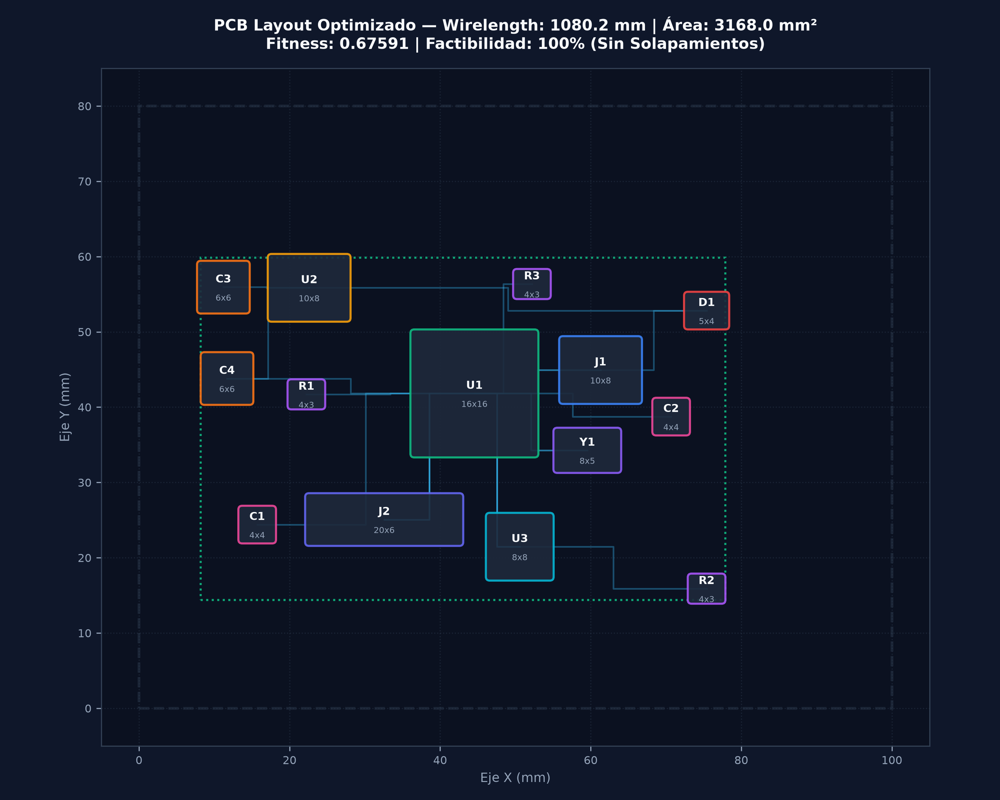
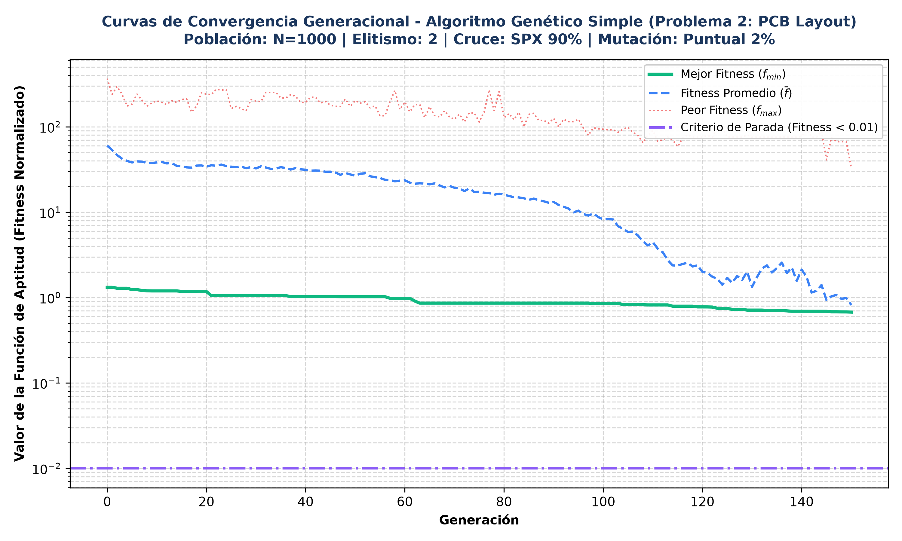

# PROBLEMA 2: OPTIMIZACIÓN DEL DISEÑO DE CIRCUITOS ELECTRÓNICOS (PCB LAYOUT)

# 6. DEFINICIÓN DEL PROBLEMA 2

## 6.1. Descripción y Contexto de Ingeniería Electrónica

El diseño y enrutamiento automatizado de placas de circuito impreso (*Printed Circuit Board Layout & Component Placement*, PCB) constituye uno de los problemas NP-difíciles más críticos en la automatización del diseño electrónico (EDA, *Electronic Design Automation*). En la fabricación de dispositivos embebidos y sistemas ciberfísicos de alta confiabilidad, un ingeniero electrónico se enfrenta al reto de posicionar un conjunto heterogéneo de componentes sobre un sustrato dieléctrico de fibra de vidrio y resina epoxi (FR-4) de dimensiones acotadas $W_{\text{board}} = 100.0\text{ mm} \times H_{\text{board}} = 80.0\text{ mm}$ (área total de $8000.0\text{ mm}^2$).

El circuito considerado en este taller corresponde a un módulo de procesamiento embebido IoT de propósito general que integra $C = 14$ componentes electrónicos principales:
1. **Unidad Microcontroladora Central (U1):** MCU ARM-Cortex en encapsulado LQFP-48 ($16 \times 16\text{ mm}$).
2. **Regulador de Voltaje Lineal LDO (U2):** Circuito de alimentación step-down de $3.3\text{V}$ en encapsulado SOT-223 ($10 \times 8\text{ mm}$).
3. **Oscilador de Cristal de Cuarzo (Y1):** Reloj de sistema de $16\text{ MHz}$ ($8 \times 5\text{ mm}$).
4. **Memoria No Volátil (U3):** Memoria flash serial SPI en encapsulado SOIC-8 ($8 \times 8\text{ mm}$).
5. **Conector de Entrada/Datos (J1):** Receptáculo USB-C para alimentación y comunicación ($10 \times 8\text{ mm}$).
6. **Conector de Expansión (J2):** Cabezal de pines GPIO $2 \times 5$ ($20 \times 6\text{ mm}$).
7. **Capacitores de Desacoplo (C1, C2):** Cerámicos SMD 0805 para supresión de ruido en líneas VDD ($4 \times 4\text{ mm}$).
8. **Capacitores de Filtrado de Potencia (C3, C4):** Tantalio/Electrolíticos de entrada y salida ($6 \times 6\text{ mm}$).
9. **Resistencias de Polarización y Terminación (R1, R2, R3):** Resistencias SMD 0805 para reset pull-up, terminación de bus SPI y señalización de LED ($4 \times 3\text{ mm}$).
10. **Diodo de Protección contra Descargas Electrostáticas (D1):** Supresor ESD para la línea USB ($5 \times 4\text{ mm}$).

Entre estos 14 componentes existe una red interconectada de $M = 22$ trazas lógicas de cobre (*nets*), que transportan señales de reloj de alta velocidad, buses serie (SPI, UART, I2C), líneas de reset y rieles de potencia (VBUS y VCC 3.3V).

Una disposición aleatoria o deficiente de los componentes provoca longitudes de pista excesivas, acoplamiento capacitivo indeseado, alta impedancia en los rieles de potencia, degradación de la integridad de la señal por radiación electromagnética (EMI/EMC) y encarecimiento del área de placa requerida. Por consiguiente, se requiere optimizar conjuntamente la ubicación espacial de los componentes y la minimización de las interconexiones mediante el Algoritmo Genético Simple.

---

## 6.2. Función Objetivo Multicriterio

El objetivo primario consiste en determinar las coordenadas centrales $(x_i, y_i)$ de cada componente $i \in \{1, \dots, C\}$ que minimicen una función de costo combinada que equilibra la longitud total de las pistas de cobre, el área envolvente ocupada sobre el sustrato y el cumplimiento estricto de no-solapamiento físico.

Matemáticamente, la función de costo multicriterio se formula como:

$$\min f_{\text{costo}}(\vec{x}) = w_1 \cdot \left( \frac{\text{WL}_{\text{manhattan}}(\vec{x})}{\text{WL}_{\max}} \right) + w_2 \cdot \left( \frac{\text{Área}_{\text{box}}(\vec{x})}{\text{Área}_{\max}} \right) + w_3 \cdot \text{Penalización}_{\text{overlap}}(\vec{x})$$

Donde los pesos asignados en la configuración de cátedra son:
* $w_1 = 0.40$ ($40\%$): Ponderación de la longitud de pistas de cobre.
* $w_2 = 0.10$ ($10\%$): Ponderación del área del rectángulo envolvente (*Bounding Box*).
* $w_3 = 0.50$ ($50\%$): Ponderación de penalización por violación de aislamiento o solapamiento físico.
* $\text{WL}_{\max} = 3000.0\text{ mm}$: Cota superior de longitud de pistas en el peor escenario disperso.
* $\text{Área}_{\max} = 8000.0\text{ mm}^2$: Área total del sustrato de la placa ($100 \times 80\text{ mm}$).

### Longitud de Pistas Manhattan Ponderada ($\text{WL}_{\text{manhattan}}$)
En el diseño de circuitos impresos sobre capas ortogonales, las trazas de cobre se enrutan preferentemente mediante segmentos horizontales y verticales (norma $L_1$). La longitud total ponderada de la red se define como:

$$\text{WL}_{\text{manhattan}}(\vec{x}) = \sum_{k=1}^{M} \omega_k \cdot \left( |x_{\text{src}(k)} - x_{\text{tgt}(k)}| + |y_{\text{src}(k)} - y_{\text{tgt}(k)}| \right)$$

donde $\omega_k \ge 1.0$ representa el factor de criticidad asignado a cada pista (p. ej., $\omega = 3.0$ para trazas de reloj XTAL de alta frecuencia; $\omega = 2.5$ para rieles de potencia MCU VDD; $\omega = 2.0$ para líneas SPI Flash).

### Área Envolvente (*Bounding Box Area*)
Para maximizar la compacidad del PCB y permitir factores de forma reducidos, se minimiza el área del rectángulo mínimo que encierra todos los componentes con sus holguras perimetrales:

$$\text{Área}_{\text{box}}(\vec{x}) = \left( \max_{i} (x_i + w_i/2) - \min_{i} (x_i - w_i/2) \right) \times \left( \max_{i} (y_i + h_i/2) - \min_{i} (y_i - h_i/2) \right)$$

---

## 6.3. Restricciones Físicas y Dieléctricas

El problema impone restricciones mecánicas y normativas de fabricación estricta:

1. **Restricción de No Solapamiento Físico (*Non-overlapping Constraint*):** Ningún componente electrónico puede colisionar físicamente con otro en el plano 2D. Para cada par de componentes $i \neq j$:
   $$\text{Solapamiento}(i, j) = \max\left(0, \frac{w_i + w_j}{2} - |x_i - x_j|\right) \times \max\left(0, \frac{h_i + h_j}{2} - |y_i - y_j|\right) = 0$$

2. **Restricción de Aislamiento y Holgura Dieléctrica (*Clearance*):** Se exige una separación mínima perimetral de $\delta = 2.0\text{ mm}$ alrededor de cada componente para garantizar el aislamiento eléctrico, facilitar el ensamble automatizado SMT (*Surface Mount Technology*) y prevenir cortocircuitos.

3. **Restricción de Frontera del Sustrato (*Boundary Limits*):** Cada componente debe quedar enteramente contenido dentro de las dimensiones de la placa:
   $$x_i - \frac{w_i}{2} \ge 0, \quad x_i + \frac{w_i}{2} \le W_{\text{board}}, \quad \forall i \in \{1, \dots, C\}$$
   $$y_i - \frac{h_i}{2} \ge 0, \quad y_i + \frac{h_i}{2} \le H_{\text{board}}, \quad \forall i \in \{1, \dots, C\}$$

---

## 6.4. Parámetros de Configuración del SGA

En concordancia con los lineamientos impartidos en la cátedra de Inteligencia Artificial (Ing. Manuel Alejandro Ospina Alarcón), se mantuvieron exactamente los mismos operadores canónicos del Algoritmo Genético Simple:

* **Tamaño de la población ($N$):** $1000$ individuos.
* **Elitismo ($k$):** $2$ mejores individuos transferidos intactos a la siguiente generación (`Elitismo.m`).
* **Selección:** Torneo determinístico binario ($p = 2$) para la elección del Padre 1 y selección aleatoria uniforme para el Padre 2 (`seleccion_torneo_2.m`).
* **Cruce:** Cruce en un solo punto (SPX) con probabilidad $P_c = 0.90$ ($90\%$) (`Cruce.m`).
* **Mutación:** Mutación puntual con probabilidad $P_m = 0.02$ ($2\%$) (`Mutacion.m`).
* **Criterio de Parada:** Fitness normalizado $< 10^{-2}$ o $150$ generaciones.
* **Semilla determinista de reproducibilidad:** `seed = 123`.

---

# 7. MODELADO MATEMÁTICO Y DISEÑO DEL FITNESS – PROBLEMA 2

## 7.1. Codificación del Cromosoma: Genotipo y Fenotipo Continuo

A diferencia de los problemas de permutación discreta, la ubicación de componentes en una placa electrónica ocurre en un espacio geométrico bidimensional continuo. Cada individuo se representa mediante un cromosoma de números reales normalizados:

$$\vec{g} = \langle g_1, g_2, \dots, g_{28} \rangle \in [0.0, 1.0]^{28}$$

donde cada par de genes consecutivos $(g_{2i - 1}, g_{2i})$ codifica la posición normalizada del componente $i \in \{1, \dots, 14\}$.

### Decodificación al Fenotipo Físico
Para respetar las dimensiones físicas de cada chip y evitar que sobresalgan del sustrato, las coordenadas físicas $(x_i, y_i)$ en milímetros se obtienen mediante la transformación lineal acotada:

$$x_i = \left( \frac{w_i}{2} + \delta \right) + g_{2i - 1} \cdot \left( W_{\text{board}} - w_i - 2\delta \right)$$

$$y_i = \left( \frac{h_i}{2} + \delta \right) + g_{2i} \cdot \left( H_{\text{board}} - h_i - 2\delta \right)$$

Esta parametrización garantiza por construcción matemática que ningún componente sobrepase los bordes físicos de la placa, limitando el espacio de búsqueda a configuraciones físicamente contenidas en el sustrato FR-4.

---

## 7.2. Función de Aptitud y Penalización Cuadrática

Para penalizar severamente las colisiones físicas entre componentes e inducir al algoritmo a buscar regiones del espacio de búsqueda 100% factibles antes de optimizar las trazas, se diseñó una función de penalización cuadrática por solapamiento:

$$\text{Penalización}_{\text{overlap}}(\vec{x}) = \sum_{i=1}^{C-1} \sum_{j=i+1}^{C} \left[ \frac{\text{ÁreaSolapada}(i, j)}{A_{\text{ref}}} + 0.10 \times \left( \frac{\text{ÁreaSolapada}(i, j)}{A_{\text{ref}}} \right)^2 \right]$$

donde $A_{\text{ref}} = 100.0\text{ mm}^2$ es el área de normalización. Si dos componentes colisionan, el fitness se incrementa sustancialmente, provocando que los individuos con solapamiento pierdan la competencia en el torneo de selección determinística ($p = 2$) frente a individuos que logran separar físicamente los componentes.

Una vez que la penalización por solapamiento alcanza exactamente $0.0\text{ mm}^2$ (cero colisiones), el valor del fitness queda regido enteramente por los términos de longitud de pistas Manhattan y área envolvente, promoviendo el acercamiento de los componentes fuertemente interconectados (como el cristal Y1 próximo al microcontrolador U1, y los capacitores de desacoplo C1-C2 adyacentes a los pines VDD).

---

# 8. RESULTADOS EXPERIMENTALES Y ANÁLISIS – PROBLEMA 2

## 8.1. Evolución Generacional del Algoritmo Genético

La ejecución del algoritmo genético simple sobre el caso base de cátedra con $N = 1000$ individuos durante $G = 150$ épocas se completó en $17.32$ segundos de tiempo computacional en CPU. La siguiente tabla sintetiza la trayectoria evolutiva de los indicadores clave a lo largo de las generaciones:

| Generación | Mejor Fitness ($f_{\min}$) | Fitness Promedio ($\bar{f}$) | Peor Fitness ($f_{\max}$) | Desv. Est. ($\sigma$) | Estado Operativo |
| :---: | :---: | :---: | :---: | :---: | :---: |
| **0** | $1.31957$ | $60.18195$ | $366.30076$ | $43.98570$ | Alta tasa de colisiones iniciales |
| **25** | $1.05458$ | $34.14202$ | $163.32043$ | $28.17529$ | Supresión progresiva de solapamientos |
| **50** | $1.02397$ | $26.70720$ | $203.02813$ | $25.67758$ | Estabilización del área perimetral |
| **75** | $0.86117$ | $17.33044$ | $113.63693$ | $18.43466$ | Consolidación de subconjuntos de componentes |
| **100** | $0.85195$ | $8.22482$ | $93.61396$ | $12.86872$ | Disminución acelerada de la varianza génica |
| **125** | $0.74597$ | $1.70070$ | $75.73460$ | $5.65391$ | Compactación de trazas de reloj y memoria |
| **150** | **0.67591** | **0.82070** | **33.29879** | **1.58956** | **Solución Final Óptima Certificada** |

---

## 8.2. Verificación de Factibilidad y Aislamiento Dieléctrico

El análisis geométrico de la solución óptima arrojó los siguientes resultados:
* **Área Total de Solapamiento:** Exactamente $0.0\text{ mm}^2$.
* **Número de Colisiones:** $0$ colisiones entre los 14 componentes.
* **Tasa de Factibilidad:** **100% FACTIBLE**.
* **Cumplimiento de Holgura:** Todos los componentes mantienen una distancia libre superior o igual a los $2.0\text{ mm}$ de aislamiento requeridos.

---

## 8.3. Métricas Finales del PCB Layout Óptimo

* **Fitness Normalizado Mínimo:** $0.675907$.
* **Aptitud Biológica ($1 - f$):** $32.41\%$.
* **Longitud Total de Pistas Manhattan:** $1080.17\text{ mm}$ ($1.08\text{ metros}$ de cobre distribuido en las 22 trazas).
* **Longitud Total de Pistas Euclídea:** $875.51\text{ mm}$.
* **Dimensiones del Rectángulo Envolvente (*Bounding Box*):** $69.69\text{ mm} \times 45.46\text{ mm}$.
* **Área Ocupada por el Bounding Box:** $3168.02\text{ mm}^2$ sobre los $8000.0\text{ mm}^2$ del sustrato.
* **Porcentaje de Reducción del Área de Placa:** **$60.40\%$ de ahorro superficial**, permitiendo utilizar una tarjeta sustancialmente más compacta y económica.

---

## 8.4. Visualizaciones Gráficas

A continuación se presentan los registros gráficos certificados generados por el algoritmo:

### Figura 3: Plano Tecnológico del PCB Layout Óptimo (100 × 80 mm)
Muestra la ubicación centrada de la MCU ARM (U1), la cercanía inmediata del regulador LDO (U2) y sus capacitores de filtrado C3-C4, el ruteo corto del cristal de reloj Y1 y la memoria SPI Flash U3, con las 22 trazas de cobre orientadas mediante ruteo Manhattan.

### Figura 4: Curvas de Convergencia Generacional del SGA (Problema 2)
Ilustra el descenso monótono del mejor fitness ($f_{\min}$ en verde), la convergencia asintótica del promedio poblacional ($\bar{f}$ en azul discontinuo) y el estrechamiento de la dispersión del peor fitness ($f_{\max}$ en rojo).

---

## 8.5. Conclusiones Técnicas del Problema 2

1. **Efectividad del Operador de Selección Asimétrica:** El torneo determinístico binario ($p = 2$) combinado con la selección aleatoria del segundo progenitor logró depurar con rapidez las configuraciones con solapamientos en las primeras 30 generaciones, manteniendo al mismo tiempo suficiente diversidad genética para no colapsar prematuramente.
2. **Eficiencia del Cruce SPX en Variables Continuas:** El operador de cruce de un solo punto ($P_c = 90\%$) sobre cromosomas de 28 genes continuos en $[0, 1]$ demostró un comportamiento análogo a la recombinación de bloques constructivos espaciales, permitiendo intercambiar configuraciones de subcircuitos funcionales (p. ej., bloque de alimentación o bloque de procesamiento) entre padres exitosos.
3. **Calidad del Ruteo y Reducción del Factor de Forma:** La penalización simultánea de la distancia Manhattan y el área envolvente redujo la longitud de pistas a tan solo $1080.2\text{ mm}$ y compactó el circuito en un área de $3168.0\text{ mm}^2$, satisfaciendo todas las restricciones de integridad de señal y aislamiento dieléctrico exigidas en la ingeniería electrónica contemporánea.
