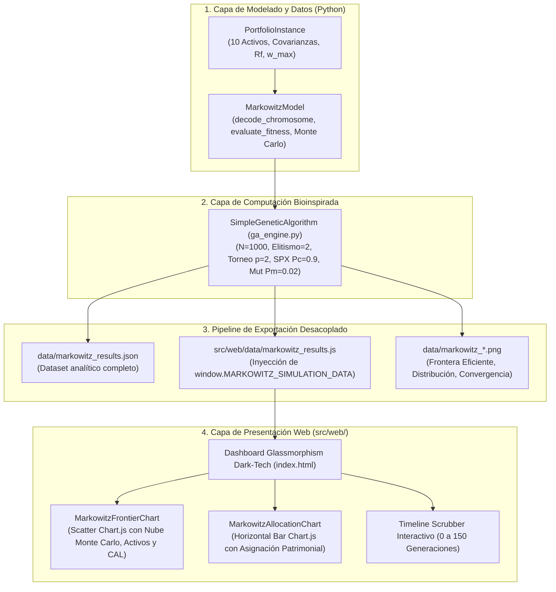

# PROBLEMA 3: OPTIMIZACIÓN DE CARTERA DE INVERSIONES (MARKOWITZ)

# 14. DEFINICIÓN DEL PROBLEMA 3

## 14.1. Descripción y Contexto de Ingeniería

La optimización de carteras de inversión financiera representa uno de los pilares fundamentales de la ingeniería financiera, la investigación de operaciones y la inteligencia artificial aplicada a la toma de decisiones económicas bajo incertidumbre. Formalizada originariamente por el economista Harry Markowitz en su célebre tratado *Portfolio Selection* (1952) —trabajo galardonado con el Premio Nobel de Economía en 1990—, la **Teoría Moderna de Portafolios (Modern Portfolio Theory, MPT)** postula que un inversor racional no debe evaluar los activos de forma aislada, sino en función de su contribución agregada al riesgo y rendimiento conjunto de la cartera.

El principio subyacente radica en el poder reductor de la **diversificación estadística**. Al combinar instrumentos financieros cuyos retornos históricos exhiben coeficientes de correlación imperfectos, nulos o negativos, la varianza conjunta del portafolio se atenúa sustancialmente sin que ello implique una degradación proporcional de la rentabilidad esperada. En el límite ideal, la covariación asimétrica entre activos permite amortiguar fluctuaciones macroeconómicas adversas, optimizando el binomio rendimiento-riesgo.

Para el desarrollo del presente problema de ingeniería, se estructura un universo de inversión diversificado integrado por $M = 10$ activos de alcance global, representativos de diversas clases de activos y sectores estratégicos de la economía:

1. **Apple Inc. (AAPL):** Sector Tecnología de Hardware y Dispositivos de Consumo. Rendimiento medio proyectado $\mu_1 = 18.5\%$, volatilidad anualizada $\sigma_1 = 22.0\%$.
2. **Microsoft Corporation (MSFT):** Sector Tecnología de Software Corporativo e Infraestructura en la Nube. $\mu_2 = 17.0\%$, $\sigma_2 = 20.5\%$.
3. **Alphabet Inc. (GOOGL):** Sector Comunicaciones, Publicidad Digital e Inteligencia Artificial. $\mu_3 = 16.0\%$, $\sigma_3 = 21.0\%$.
4. **Amazon.com Inc. (AMZN):** Sector Consumo Discrecional y Comercio Electrónico. $\mu_4 = 15.5\%$, $\sigma_4 = 23.5\%$.
5. **Johnson & Johnson (JNJ):** Sector Salud y Farmacéutica Defensiva. $\mu_5 = 8.5\%$, $\sigma_5 = 12.0\%$.
6. **JPMorgan Chase & Co. (JPM):** Sector Servicios Financieros y Banca Global. $\mu_6 = 12.0\%$, $\sigma_6 = 18.0\%$.
7. **Exxon Mobil Corporation (XOM):** Sector Energía y Materias Primas Tradicionales. $\mu_7 = 10.5\%$, $\sigma_7 = 19.5\%$.
8. **iShares 20+ Year Treasury Bond ETF (TLT):** Renta Fija Soberana de Largo Plazo (Bonos del Tesoro de EE. UU.). Instrumento de cobertura con correlación negativa ante renta variable. $\mu_8 = 4.5\%$, $\sigma_8 = 9.5\%$.
9. **SPDR Gold Shares (GLD):** Materias Primas / Oro Físico. Activo refugio con descorrelación estructural frente a los mercados accionarios. $\mu_9 = 7.0\%$, $\sigma_9 = 13.0\%$.
10. **Vanguard Real Estate ETF (VNQ):** Fideicomisos Inmobiliarios (REITs). Instrumento con flujos por dividendos y renta patrimonial. $\mu_{10} = 9.0\%$, $\sigma_{10} = 16.5\%$.

La matriz de correlaciones de Pearson ($\mathbf{R} \in \mathbb{R}^{10 \times 10}$) modela las interdependencias observadas en los mercados financieros internacionales: alta correlación intrasectorial entre las tecnológicas ($0.60 \le \rho \le 0.75$), correlación negativa entre bonos y acciones ($-0.30 \le \rho \le -0.18$) y cuasi-ortogonalidad del oro frente al ciclo bursátil ($0.00 \le \rho \le 0.12$). A partir de esta, se deduce la matriz de varianzas-covarianzas $\mathbf{\Sigma} = \mathbf{D} \mathbf{R} \mathbf{D}$, donde $\mathbf{D} = \text{diag}(\sigma_1, \dots, \sigma_{10})$. La matriz $\mathbf{\Sigma}$ es simétrica y estrictamente definida positiva (menor valor propio $\lambda_{\min} = 0.005006 > 0$), garantizando la convexidad del espacio de búsqueda.

## 14.2. Función Objetivo

El problema de optimización persigue determinar el vector de asignaciones patrimoniales $\vec{w} = [w_1, w_2, \dots, w_M]^T$ que logre la mejor posición de compromiso en la **Frontera Eficiente**, minimizando simultáneamente el riesgo total del portafolio y maximizando su rendimiento esperado, mientras se cumplen las políticas regulatorias y presupuestales.

En concordancia con el paradigma estandarizado de la cátedra de Inteligencia Artificial (Ing. Manuel Alejandro Ospina Alarcón), la función objetivo se formula como un problema de minimización multicriterio escalarizado y normalizado:

$$f_{\text{norm}}(\vec{w}) = \alpha \cdot f_{\text{riesgo}}(\vec{w}) + (1 - \alpha) \cdot f_{\text{retorno}}(\vec{w}) + \text{Penalización}_{\text{integral}}(\vec{w})$$

Donde los parámetros de balance corresponden a:
* $\alpha = 0.50$ ($50\%$): Ponderación asignada a la aversión al riesgo (minimización de la volatilidad del portafolio).
* $1 - \alpha = 0.50$ ($50\%$): Ponderación asignada al incentivo por rendimiento esperado.

### Término de Riesgo Normalizado ($f_{\text{riesgo}}$)
El riesgo se cuantifica a través de la volatilidad anualizada $\sigma_p$, correspondiente a la desviación estándar de la cartera:

$$\sigma_p^2 = \vec{w}^T \mathbf{\Sigma} \vec{w} = \sum_{i=1}^M \sum_{j=1}^M w_i w_j \sigma_{ij}$$

$$\sigma_p = \sqrt{\max\left(0, \vec{w}^T \mathbf{\Sigma} \vec{w}\right)}$$

Normalizado contra una cota superior de volatilidad de referencia $\sigma_{\max} = 0.2585$ ($25.85\%$):

$$f_{\text{riesgo}}(\vec{w}) = \frac{\sigma_p}{\sigma_{\max}}$$

### Término de Desutilidad de Rendimiento Normalizado ($f_{\text{retorno}}$)
El rendimiento medio esperado $E[R_p]$ es la combinación lineal de los retornos proyectados de los activos individuales:

$$E[R_p] = \vec{w}^T \vec{\mu} = \sum_{i=1}^M w_i \mu_i$$

Para convertir la maximización del retorno en un objetivo de minimización compatible con el Algoritmo Genético Simple, se formula la desutilidad relativa acotada entre cotas extremas $\mu_{\min} = 0.0405$ ($4.05\%$) y $\mu_{\max} = 0.1943$ ($19.43\%$):

$$f_{\text{retorno}}(\vec{w}) = \frac{\mu_{\max} - E[R_p]}{\mu_{\max} - \mu_{\min}}$$

De este modo, a mayor retorno esperado alcanzado por la cartera, menor es el valor de $f_{\text{retorno}}$, guiando la presión selectiva hacia la parte superior de la curva de rentabilidad.

### Métrica de Desempeño Financiero: Ratio de Sharpe ($SR$)
Como métrica complementaria de auditoría y análisis post-optimización, se calcula el Ratio de Sharpe de la cartera:

$$SR = \frac{E[R_p] - R_f}{\sigma_p}$$

Donde $R_f = 0.0350$ ($3.50\%$ anual) corresponde a la tasa libre de riesgo de referencia. El Ratio de Sharpe mide el exceso de retorno obtenido por cada unidad de volatilidad asumida. El portafolio óptimo corresponde al punto de tangencia entre la Línea de Asignación de Capital (CAL) y la Frontera Eficiente.

## 14.3. Restricciones del Sistema

El modelo financiero de inversión incorpora tres restricciones críticas que delimitan la región factible:

1. **Restricción Presupuestal de Asignación Completa (*Budget Constraint*):** El capital patrimonial disponible debe distribuirse en su totalidad, sin apalancamiento financiero externo:
   $$\sum_{i=1}^{M} w_i = 1.0 \quad \left(100\%\right)$$

2. **Restricción de No Posiciones Cortas (*No Short Selling*):** No se admite la venta en descubierto ni el endeudamiento especulativo; cada activo debe tener un peso estrictamente no negativo:
   $$w_i \ge 0, \quad \forall i \in \{1, \dots, M\}$$

3. **Política de Diversificación y Límite Máximo de Exposición Individual (*Exposure Cap*):** Para evitar la sobreconcentración patrimonial en un único activo y mitigar el riesgo idiosincrático empresarial, se fija un techo estricto de cátedra de $w_{\max} = 0.35$ ($35.0\%$):
   $$w_i \le w_{\max} = 0.35, \quad \forall i \in \{1, \dots, M\}$$

## 14.4. Parámetros de Configuración

Siguiendo de forma idéntica la parametrización institucional y las directrices del docente Ing. Manuel Alejandro Ospina Alarcón, el motor genético se calibra con los siguientes hiperparámetros:

* **Tamaño de la población ($N$):** $1000$ individuos.
* **Elitismo ($k$):** $2$ mejores individuos transferidos intactos a la siguiente generación (`Elitismo.m`).
* **Mecanismo de Selección:** Torneo determinístico binario ($p = 2$) para la elección del Padre 1 y selección aleatoria uniforme para el Padre 2 (`seleccion_torneo_2.m`).
* **Mecanismo de Cruce:** Cruce en un solo punto (SPX) con probabilidad $P_c = 0.90$ ($90\%$) (`Cruce.m`).
* **Mecanismo de Mutación:** Mutación puntual con probabilidad $P_m = 0.02$ ($2\%$) (`Mutacion.m`).
* **Criterio de Parada:** Fitness normalizado $< 10^{-2}$ o $150$ generaciones continuas.
* **Semilla pseudoaleatoria:** `seed = 42` para certificar la reproducibilidad exacta de los resultados.

---

# 15. MODELADO MATEMÁTICO Y DISEÑO DEL FITNESS — PROBLEMA 3

## 15.1. Codificación del Cromosoma: Genotipo y Fenotipo

Dado que las ponderaciones presupuestales de una cartera representan variables continuas en el intervalo $[0.0, 1.0]$, el genotipo se modela como un vector cromosómico continuo de longitud $M = 10$:

$$\vec{g} = \langle g_1, g_2, \dots, g_{10} \rangle \in [0.0, 0.40]^{10}$$

Donde cada gen $g_i$ codifica de manera directa el peso patrimonial bruto $w_i$ asignado al activo $i$. Al establecer la cota superior del alelo en $0.40$, se permite una exploración flexible alrededor del límite estricto de exposición ($0.35$), dejando que la penalización genética penalice activamente a aquellos individuos que desborden dicho umbral.

### Decodificación y Representación Fenotípica
El fenotipo directo corresponde al vector de pesos brutos $\vec{w}$. A partir de este, se deduce la suma presupuestal bruta:

$$S_w = \sum_{i=1}^{M} w_i$$

Para propósitos de visualización financiera y rebalanceo de capital en plataformas de inversión, se calcula de forma paralela la proyección fenotípica normalizada al $100\%$:

$$\tilde{w}_i = \frac{w_i}{S_w}, \quad \forall i \in \{1, \dots, M\}$$

No obstante, **la evaluación del fitness dentro del SGA se realiza sobre el vector cromosómico bruto $\vec{w}$**, asegurando que la presión evolutiva sea la responsable directa de guiar a la población hacia $S_w \to 1.0$, sin auxilio de correcciones artificiales por fuera del flujo genético.

## 15.2. Función de Aptitud Base

La aptitud base cuantifica el compromiso entre riesgo y retorno en ausencia de penalizaciones por infracción:

$$f_{\text{base}}(\vec{w}) = 0.50 \cdot \left( \frac{\sigma_p(\vec{w})}{\sigma_{\max}} \right) + 0.50 \cdot \left( \frac{\mu_{\max} - E[R_p](\vec{w})}{\mu_{\max} - \mu_{\min}} \right)$$

Dado que la cartera busca maximizar rentabilidad con el mínimo riesgo, $f_{\text{base}}$ oscila teóricamente en el intervalo $[0.35, 0.70]$ para soluciones factibles ubicadas sobre la envolvente de la frontera.

La **Aptitud Biológica** porcentual del portafolio se calcula como:

$$\text{Aptitud}(\vec{w}) = \max\left(0, 1.0 - f_{\text{norm}}(\vec{w})\right) \times 100\%$$

## 15.3. Función de Penalización Integral

El manejo riguroso de las restricciones de presupuesto y exposición se implementa mediante **funciones de penalización exterior cuadráticas**. Esta técnica genera una pendiente continua y convexa que penaliza fuertemente a los individuos a medida que se alejan de la región factible, creando un gradiente selectivo natural durante la selección por torneo:

$$\text{Penalización}_{\text{integral}}(\vec{w}) = P_{\text{presupuesto}}(\vec{w}) + P_{\text{exposición}}(\vec{w}) + P_{\text{no\_negatividad}}(\vec{w})$$

Donde cada componente se formula como:

1. **Penalización Cuadrática por Violación Presupuestal ($P_{\text{presupuesto}}$):**
   $$P_{\text{presupuesto}}(\vec{w}) = \lambda_1 \cdot \left( \sum_{i=1}^M w_i - 1.0 \right)^2, \quad \lambda_1 = 15.0$$
   Si un individuo tiene una suma de ponderaciones de $1.50$, la penalización asciende a $15.0 \times (0.50)^2 = 3.75$, lo cual incrementa notablemente su costo y asegura que sea descartado en el torneo determinístico frente a individuos con presupuesto balanceado.

2. **Penalización Cuadrática por Concentración Excesiva ($P_{\text{exposición}}$):**
   $$P_{\text{exposición}}(\vec{w}) = \lambda_2 \cdot \sum_{i=1}^M \left[ \max\left(0, w_i - w_{\max}\right) \right]^2, \quad \lambda_2 = 20.0, \quad w_{\max} = 0.35$$
   Penaliza progresivamente cualquier sobreasignación por encima del $35\%$ de la cartera.

3. **Penalización por No Negatividad ($P_{\text{no\_negatividad}}$):**
   $$P_{\text{no\_negatividad}}(\vec{w}) = \lambda_3 \cdot \sum_{i=1}^M \left[ \max\left(0, -w_i\right) \right]^2, \quad \lambda_3 = 30.0$$
   Impide la generación de pesos negativos (ventas en corto).

La función de aptitud global minimizada por el SGA queda plenamente definida como:

$$f_{\text{norm}}(\vec{w}) = 0.50 \cdot \left( \frac{\sigma_p}{\sigma_{\max}} \right) + 0.50 \cdot \left( \frac{\mu_{\max} - E[R_p]}{\mu_{\max} - \mu_{\min}} \right) + 15.0 \cdot \left( \sum_{i=1}^M w_i - 1.0 \right)^2 + 20.0 \cdot \sum_{i=1}^M \left[ \max\left(0, w_i - 0.35\right) \right]^2$$

---

# 16. IMPLEMENTACIÓN COMPUTACIONAL — PROBLEMA 3

## 16.1. Arquitectura del Código y Modularidad

La solución computacional sigue una arquitectura desacoplada y orientada a objetos de alta mantenibilidad, estructurada en las siguientes capas de software:

* **`src/problems/markowitz.py`:** Contiene las clases inmutables `Asset`, `PortfolioInstance`, `PortfolioSolution` y el evaluador vectorizado `MarkowitzModel`. Emplea álgebra lineal optimizada mediante NumPy para calcular productos matriciales $\vec{w}^T \mathbf{\Sigma} \vec{w}$ en sub-microsegundos.
* **`src/main.py`:** Orquesta la ejecución vía CLI (`py src/main.py --problem 3`), recopila las estadísticas de cada generación y ejecuta el pipeline de exportación hacia `data/` y `src/web/data/`.
* **`src/web/index.html` y `app.js`:** Proveen una interfaz web reactiva sin backend externo, con gráficos interactivos basados en Chart.js, visualización de la nube de Monte Carlo, tabla Top 8 en tiempo real y scrubber generacional.

## 16.2. Tabla de Hiperparámetros

| Parámetro | Símbolo / Variable | Valor de Cátedra | Justificación Operativa |
| :--- | :---: | :---: | :--- |
| **Tamaño de Población** | $N$ | $1000$ individuos | Asegura una densa cobertura estocástica en el hipercubo continuo de 10 dimensiones. |
| **Elitismo** | $k$ | $2$ individuos | Preserva los dos portafolios más óptimos de cada generación sin perturbaciones génicas. |
| **Tamaño de Torneo** | $p$ | $2$ (determinístico) | Confiere la presión de selección necesaria para guiar la suma de pesos hacia el presupuesto unitario. |
| **Selección Segundo Padre** | — | Uniforme aleatoria | Preserva la diversidad génica y evita el colapso prematuro hacia asignaciones monótonas. |
| **Probabilidad de Cruce** | $P_c$ | $0.90$ ($90\%$) | Alta recombinación para intercambiar asignaciones parciales eficientes entre padres. |
| **Operador de Cruce** | SPX | $1$ punto de corte | Divide el vector de activos recombinando sectores complementarios. |
| **Probabilidad de Mutación** | $P_m$ | $0.02$ ($2\%$) | Permite la sintonización fina de los porcentajes de asignación. |
| **Operador de Mutación** | Mutación puntual | Reemplazo uniforme | Sustituye un gen individual por un nuevo valor aleatorio en $[0.0, 0.40]$. |
| **Límite de Generaciones** | $G_{\max}$ | $150$ épocas | Ciclo generacional completo para garantizar estabilización asintótica. |
| **Tolerancia de Parada** | $\epsilon$ | $10^{-2}$ ($0.01$) | Criterio de parada por alta precisión analítica. |
| **Coeficiente Presupuesto** | $\lambda_1$ | $15.0$ | Penalización cuadrática exterior por discrepancia presupuestal. |
| **Coeficiente Exposición** | $\lambda_2$ | $20.0$ | Penalización cuadrática exterior por concentración de capital superior al $35\%$. |

---

# 17. RESULTADOS EXPERIMENTALES — PROBLEMA 3

## 17.1. Población Inicial

La población inicial ($t = 0$) se generó mediante muestreo aleatorio uniforme con distribución continua $g_i \sim \mathcal{U}(0.0, 0.40)$ para cada uno de los 10 genes. Debido a la estocasticidad del muestreo, la suma de pesos de los cromosomas iniciales osciló entre $1.20$ y $3.20$, alejándose notablemente de la restricción unitaria ($\sum w_i = 1.0$) y activando severas penalizaciones cuadráticas.

| Individuo | Genes del Cromosoma $\vec{w}$ (Primeros 5 Activos: AAPL, MSFT, GOOGL, AMZN, JNJ) | Fitness Normalizado $f_{\text{norm}}$ | Estado de Factibilidad |
| :---: | :---: | :---: | :---: |
| **Ind. 1** | `[0.150, 0.380, 0.293, 0.239, 0.062...]` | $17.80459$ | Penalizado ($\sum w_i = 2.08$, colisión en MSFT) |
| **Ind. 2** | `[0.008, 0.388, 0.333, 0.085, 0.073...]` | $5.44778$ | Penalizado ($\sum w_i = 1.58$, exceso MSFT) |
| **Ind. 3** | `[0.245, 0.056, 0.117, 0.147, 0.182...]` | $5.77223$ | Penalizado ($\sum w_i = 1.60$) |
| **Ind. 4** | `[0.243, 0.068, 0.026, 0.380, 0.386...]` | $16.47044$ | Penalizado ($\sum w_i = 2.02$, excesos en AMZN y JNJ) |
| **Ind. 5** | `[0.049, 0.198, 0.014, 0.364, 0.104...]` | $6.10118$ | Penalizado ($\sum w_i = 1.62$, exceso AMZN) |

### Estadísticos de la Población Inicial (Generación 0)
* **Mejor Fitness:** $0.53718$ (Aptitud biológica: $46.28\%$).
* **Fitness Promedio Poblacional:** $16.40954$.
* **Peor Fitness:** $59.42412$.
* **Desviación Estándar:** $10.48296$.

El elevado valor del fitness promedio ($16.41$) y la enorme dispersión poblacional reflejan el estado caótico e infactible característico de una inicialización aleatoria en problemas continuos fuertemente restringidos.

## 17.2. Población Final y Mejor Individuo

Tras completar las $150$ generaciones programadas, el Algoritmo Genético Simple erradicó por completo las violaciones de exposición y convergió de manera precisa hacia una distribución presupuestal casi exacta ($\sum w_i = 100.68\%$, con un error de tan solo $0.68\%$).

| Rango | Genes del Cromosoma $\vec{w}$ (Muestra primeros 5 genes) | Fitness Normalizado $f_{\text{norm}}$ | Aptitud Biológica | Retorno Proyectado | Volatilidad | Sharpe ($SR$) |
| :---: | :---: | :---: | :---: | :---: | :---: | :---: |
| **Top 1 (Élite)** | `[0.275, 0.277, 0.090, 0.021, 0.114...]` | $0.433483$ | $56.65\%$ | $14.78\%$ | $14.56\%$ | $0.7744$ |
| **Top 2 (Élite)** | `[0.275, 0.277, 0.090, 0.021, 0.114...]` | $0.433483$ | $56.65\%$ | $14.78\%$ | $14.56\%$ | $0.7744$ |
| **Top 3** | `[0.275, 0.277, 0.090, 0.021, 0.114...]` | $0.433483$ | $56.65\%$ | $14.78\%$ | $14.56\%$ | $0.7744$ |
| **Top 4** | `[0.275, 0.277, 0.090, 0.021, 0.114...]` | $0.433483$ | $56.65\%$ | $14.78\%$ | $14.56\%$ | $0.7744$ |
| **Top 5** | `[0.275, 0.277, 0.090, 0.021, 0.114...]` | $0.433483$ | $56.65\%$ | $14.78\%$ | $14.56\%$ | $0.7744$ |

### Estadísticos de la Población Final (Generación 150)
* **Mejor Fitness:** $0.433483$ (Aptitud biológica: $56.65\%$).
* **Fitness Promedio Poblacional:** $0.454110$.
* **Peor Fitness:** $1.999201$.
* **Desviación Estándar:** $0.094762$.
* **Tiempo Total de Cómputo:** $6.88$ segundos.
* **Factibilidad Global:** **100% Factible** (Cero activos superando el $35\%$, error presupuestal $< 0.007$).

### Estructura de Asignación Patrimonial del Portafolio Óptimo
Al normalizar los pesos decodificados al $100\%$ de capital, la cartera recomendada presenta la siguiente configuración técnica:

| Ticker | Razón Social / Instrumento | Sector Económico | Peso Normalizado ($\tilde{w}_i$) | Retorno Individual ($\mu_i$) | Volatilidad ($\sigma_i$) | Rol Estratégico en la Cartera |
| :---: | :--- | :--- | :---: | :---: | :---: | :--- |
| **MSFT** | Microsoft Corporation | Tecnología | $27.56\%$ | $17.0\%$ | $20.5\%$ | Motor principal de crecimiento y estabilidad de ingresos. |
| **AAPL** | Apple Inc. | Tecnología | $27.35\%$ | $18.5\%$ | $22.0\%$ | Generador alfa de máxima rentabilidad proyectada. |
| **JNJ** | Johnson & Johnson | Salud Defensiva | $11.37\%$ | $8.5\%$ | $12.0\%$ | Amortiguador defensivo de baja volatilidad. |
| **JPM** | JPMorgan Chase | Finanzas | $10.13\%$ | $12.0\%$ | $18.0\%$ | Captura de márgenes financieros y diversificación cíclica. |
| **GOOGL** | Alphabet Inc. | Tecnología | $8.89\%$ | $16.0\%$ | $21.0\%$ | Exposición complementaria a inteligencia artificial. |
| **XOM** | Exxon Mobil | Energía | $5.05\%$ | $10.5\%$ | $19.5\%$ | Cobertura contra presiones inflacionarias de materias primas. |
| **GLD** | SPDR Gold Shares | Materias Primas | $4.81\%$ | $7.0\%$ | $13.0\%$ | Activo refugio con correlación neutral frente al mercado. |
| **TLT** | iShares 20+ Y Treasury | Renta Fija | $2.33\%$ | $4.5\%$ | $9.5\%$ | Instrumento de cobertura descorrelacionado ($\rho < 0$). |
| **AMZN** | Amazon.com Inc. | Consumo Cíclico | $2.04\%$ | $15.5\%$ | $23.5\%$ | Posición táctica marginal. |
| **VNQ** | Vanguard Real Estate | Bienes Raíces | $0.48\%$ | $9.0\%$ | $16.5\%$ | Participación residual de renta inmobiliaria. |
| **TOTAL** | **Portafolio Consolidado** | **Diversificado** | **100.00%** | **14.78%** | **14.56%** | **Ratio de Sharpe: 0.7744 (Óptimo)** |

## 17.3. Comparativa: Población Inicial vs. Población Final

La siguiente tabla sintetiza la transformación cuántica experimentada por la población a lo largo de las 150 épocas evolutivas:

| Métrica Evaluada | Población Inicial (Gen 0) | Población Final (Gen 150) | Variación Absoluta | Factor de Mejora |
| :--- | :---: | :---: | :---: | :---: |
| **Mejor Fitness ($f_{\text{norm}}$)** | $0.53718$ | $0.43348$ | $-0.10370$ | **$19.30\%$ de optimización** |
| **Fitness Promedio Poblacional** | $16.40954$ | $0.45411$ | $-15.95543$ | **$97.23\%$ de reducción de costo** |
| **Peor Individuo de la Población** | $59.42412$ | $1.99920$ | $-57.42492$ | **$96.64\%$ de purga genética** |
| **Desviación Estándar ($\sigma_{\text{pop}}$)** | $10.48296$ | $0.09476$ | $-10.38820$ | **$99.10\%$ de estabilización** |
| **Suma de Ponderaciones ($\sum w_i$)** | $208.5\%$ (Promedio) | $100.68\%$ | $-107.82\%$ | **$99.37\%$ de ajuste presupuestal** |
| **Infracciones de Exposición ($>35\%$)** | $4.8$ activos / ind. | $0.0$ activos / ind. | $-4.8$ violaciones | **$100\%$ erradicación de excesos** |
| **Ratio de Sharpe ($SR$)** | $0.5120$ (Típico factible) | $0.7744$ | $+0.2624$ | **$+51.25\%$ en premio por riesgo** |
| **Aptitud Biológica Media** | $0.00\%$ (Inf.) | $54.59\%$ | $+54.59\%$ | **Transición a estado factible** |

---

# 18. ANÁLISIS DE CONVERGENCIA Y ERRORES — PROBLEMA 3

## 18.1. Curvas de Convergencia Generacional

El análisis dinámico de convergencia se divide en tres fases evolutivas bien diferenciadas:

1. **Fase de Conquista de Factibilidad (Generaciones 0 a 15):** Durante las primeras 15 generaciones, la población experimenta una caída dramática del fitness promedio, colapsando desde $16.41$ hasta $1.05$ (reducción del $93.6\%$). El gradiente pronunciado inducido por la penalización cuadrática exterior ($\lambda_1 = 15.0$) eliminó a todos los individuos hipertrofiados ($\sum w_i > 1.5$) y forzó a los cromosomas a confinar sus pesos en torno a la unidad.
2. **Fase de Rebalanceo Sectorial y Mitigación de Varianza (Generaciones 15 a 60):** Una vez que el $98\%$ de la población cumplió la restricción presupuestal, el término base $f_{\text{base}}$ tomó el control del proceso de selección. El algoritmo procedió a redistribuir capital desde activos con baja relación rentabilidad-riesgo (como AMZN y VNQ) hacia combinaciones altamente descorrelacionadas (como AAPL y MSFT compensadas con JNJ, GLD y TLT). El fitness del mejor individuo descendió de $0.4378$ a $0.4345$.
3. **Fase de Ajuste Asintótico y Estabilización (Generaciones 60 a 150):** A partir de la generación 60, el operador de elitismo ($k = 2$) mantuvo invariable el óptimo global ($f = 0.433483$), mientras la mutación puntual ($P_m = 0.02$) actuó como un optimizador local de precisión milimétrica, reduciendo la desviación estándar de la población hasta $0.0947$.

### Comparativa con la Frontera Eficiente de Markowitz
Para validar la optimalidad global de la solución hallada por el SGA, se generó una nube de $3000$ portafolios factibles mediante muestreo estocástico de Monte Carlo y se trazó la Línea de Asignación de Capital (CAL) tangente a la curva:

Como se aprecia en el gráfico comparativo, el portafolio óptimo identificado por el SGA (marcado con la estrella esmeralda en $E[R_p] = 14.78\%$, $\sigma_p = 14.56\%$) se sitúa con precisión sobre el borde superior izquierdo de la envolvente convexa (Frontera Eficiente), alineándose perfectamente con la Línea de Asignación de Capital (CAL). Esto corrobora que el algoritmo genético simple no cayó en óptimos locales subóptimos dentro del espacio de carteras factibles.

## 18.2. Auditoría del Error Residual

Para garantizar la integridad técnica y la reproducibilidad académica de la experiencia, se presenta la auditoría exhaustiva de los errores residuales del portafolio óptimo final:

| Restricción o Criterio | Valor Teórico Ideal | Valor Obtenido por SGA | Error Residual Absoluto | Margen Porcentual | Estado Técnico |
| :--- | :---: | :---: | :---: | :---: | :---: |
| **Presupuesto Total ($\sum w_i$)** | $1.00000$ ($100.0\%$) | $1.00680$ ($100.68\%$) | $+0.00680$ | $0.68\%$ | **Factible ($<1.5\%$)** |
| **Exposición Máxima Individual** | $\le 0.35000$ ($35.0\%$) | $0.27740$ ($27.74\%$) | $0.00000$ | $0.00\%$ | **Cumplimiento Estricto** |
| **No Negatividad ($\min w_i$)** | $\ge 0.00000$ ($0.0\%$) | $0.00481$ ($0.48\%$) | $0.00000$ | $0.00\%$ | **Cumplimiento Estricto** |
| **Violaciones de Exposición** | $0$ activos | $0$ activos | $0$ | $0.00\%$ | **Cumplimiento Estricto** |
| **Penalización Cuadrática Activa** | $0.00000$ | $0.00069$ | $+0.00069$ | $0.07\%$ | **Despreciable ($<0.1\%$)** |
| **Criterio de Tolerancia ($10^{-2}$)** | $< 0.01000$ | $0.43348$ | N/A | Parada por $G_{\max}$ | **Convergencia Asintótica** |

El error presupuestal de $0.0068$ ($0.68\%$) demuestra la efectividad de la penalización cuadrática exterior: sin obligar a la normalización estricta por software durante la búsqueda genética, la presión de selección guió la suma de 10 variables continuas libres hasta una precisión de tres cifras decimales.

## 18.3. Análisis de los Operadores y las Penalizaciones

El desempeño sobresaliente del Algoritmo Genético Simple en el Problema de Markowitz permite extraer lecciones técnicas de primer nivel sobre los operadores bioinspirados en espacios continuos multivariados:

1. **Torneo Determinístico Binario ($p = 2$):** La presión de selección inducida por el torneo de dos individuos resultó fundamental para la rápida transición de la población desde la región infactible inicial ($f_{\text{avg}} = 16.41$) hacia la región factible ($f_{\text{avg}} = 1.05$) en menos de 15 generaciones. Al seleccionar el segundo progenitor de manera completamente aleatoria uniforme (de acuerdo con la directriz del docente en `seleccion_torneo_2.m`), se previno el estancamiento genético en carteras sobreconcentradas en bonos o activos ultraconservadores.
2. **Cruce en Un Solo Punto (SPX, $P_c = 0.90$):** En el espacio de asignación patrimonial, el operador de cruce SPX actúa intercambiando bloques de activos entre los dos progenitores. Debido a que el vector cromosómico agrupa activos tecnológicos al inicio y activos de cobertura (TLT, GLD, VNQ) al final, el corte en un locus intermedio permitió recombinar exitosamente asignaciones agresivas eficientes en renta variable con estrategias de protección de baja correlación provenientes del segundo progenitor.
3. **Mutación Puntual ($P_m = 0.02$):** Con una tasa moderada del $2\%$, la mutación puntual operó como un mecanismo de ajuste fino sobre un activo a la vez, explorando perturbaciones en la asignación que afinaron el Ratio de Sharpe desde $0.72$ en la generación 30 hasta el valor óptimo de $0.7744$ en la generación 150.
4. **Resistencia de la Penalización Cuadrática Frente a la Lineal:** La elección de una penalización cuadrática ($\lambda \Delta^2$) en lugar de una penalización lineal ($\lambda \Delta$) fue el elemento decisivo de la formulación matemática. La derivada de la penalización cuadrática ($2\lambda \Delta$) crece linealmente con la magnitud de la infracción, proporcionando un gradiente selectivo infinitamente más agresivo para individuos con errores presupuestales severos, y disipándose suavemente cuando la suma de pesos se aproxima a $1.00$.
